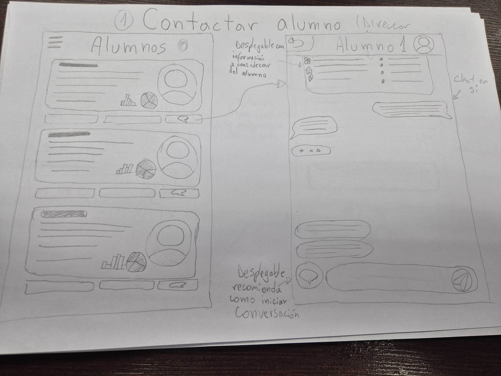
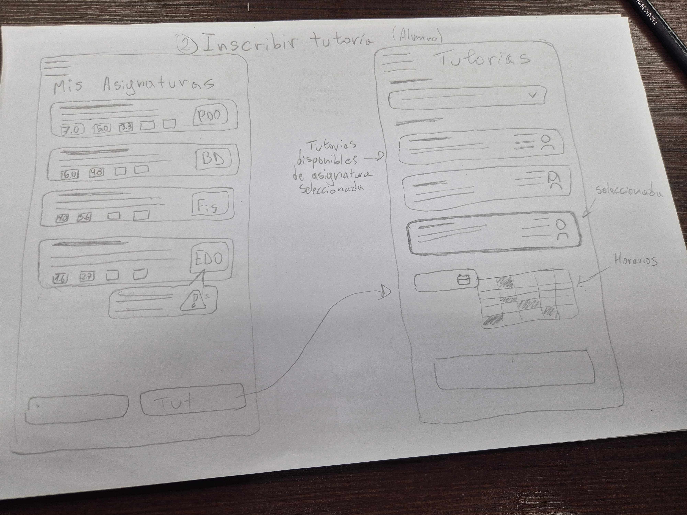
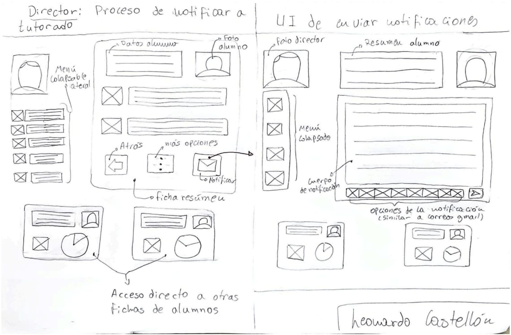
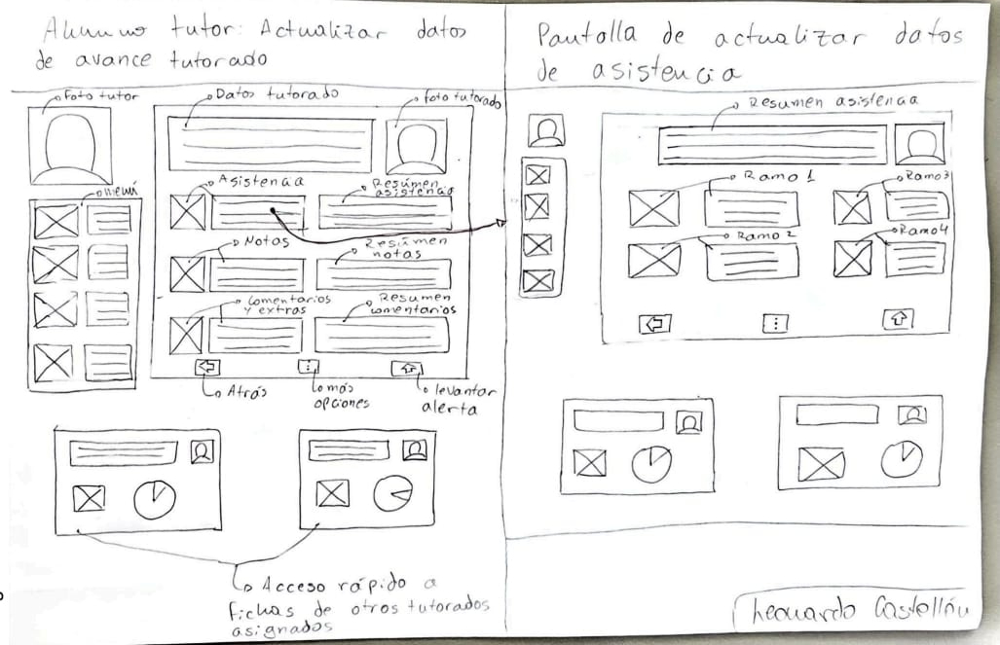
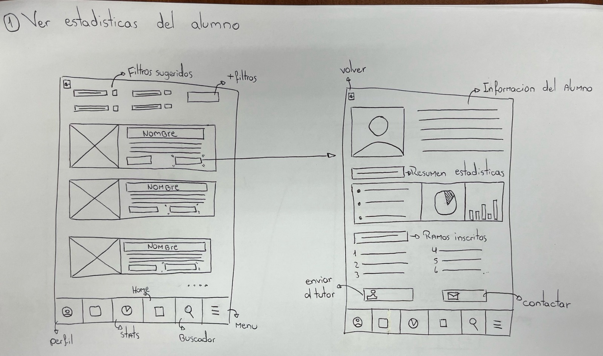
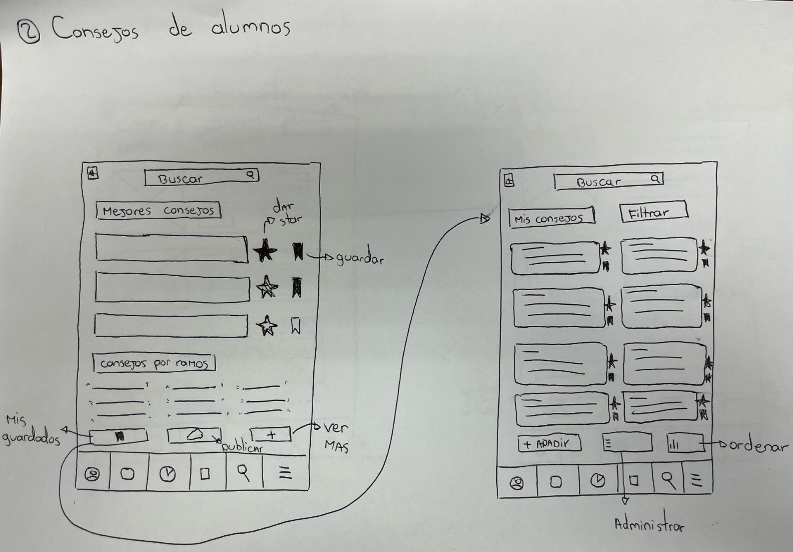
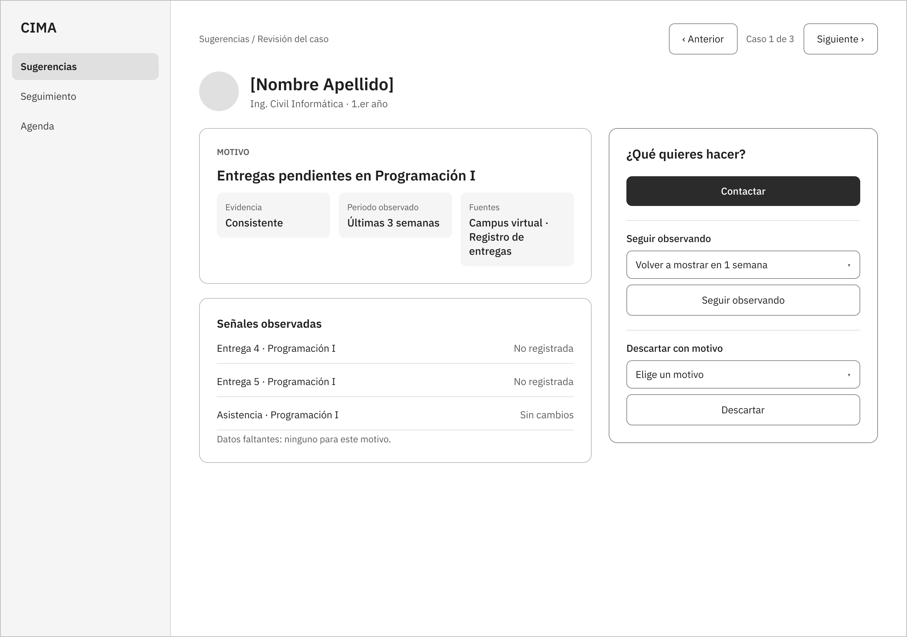
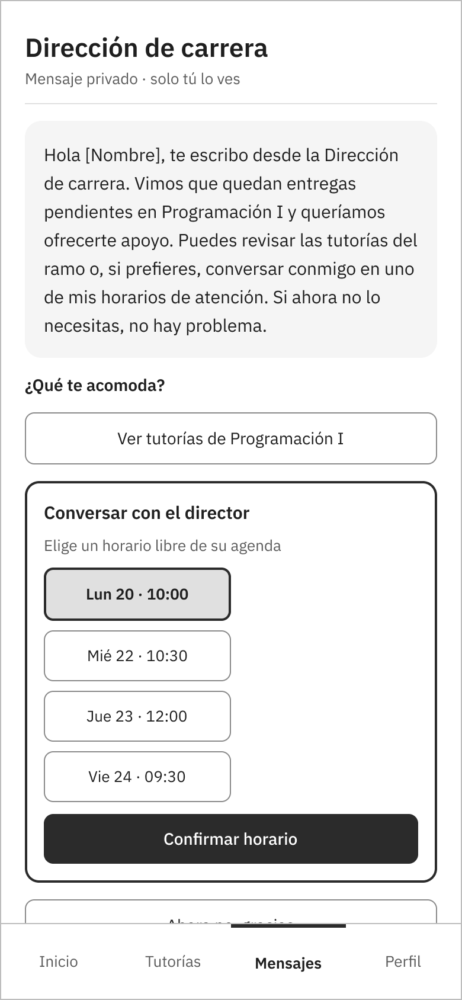
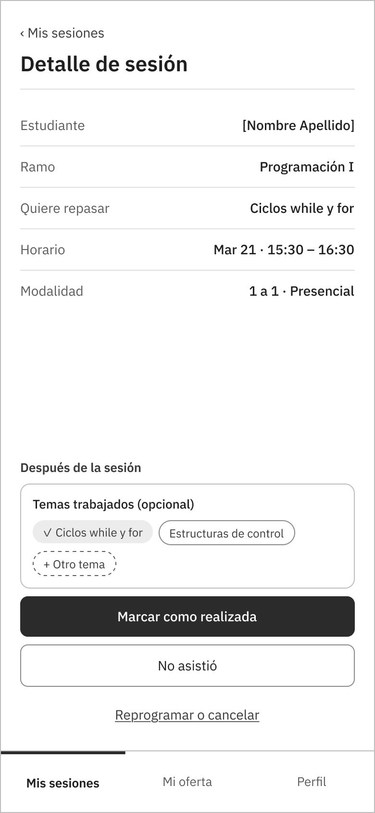

# CIMA - Confidential Intervention & Mentorship Analytics

An empathetic, privacy-first Early Warning System for academic risk management without stigmatization.

**Universidad de La Frontera · October 2026**

---

## Index

- [1. Team Identification and Roles](#1-team-identification-and-roles)
- [2. Problem Statement & Proposed Solution](#2-problem-statement--proposed-solution)
  - [2.1. Problem Statement](#21-problem-statement)
  - [2.2. Solution Overview](#22-solution-overview)
- [3. Layer: Strategy](#3-layer-strategy)
  - [3.1. UX Personas](#31-ux-personas)
  - [3.2. Value Proposition Canvas](#32-value-proposition-canvas)
- [4. Layer: Scope](#4-layer-scope)
  - [4.1. Scope Delimitation & Justification](#41-scope-delimitation--justification)
  - [4.2. Benchmarking](#42-benchmarking)
- [5. Layer: Structure](#5-layer-structure)
  - [5.1. Navigation Flow](#51-navigation-flow)
  - [5.2. Customer Journey Map](#52-customer-journey-map)
- [6. Layer: Skeleton](#6-layer-skeleton)
  - [6.1. Paper Low-Fi Sketches](#61-paper-low-fi-sketches)
  - [6.2. Consolidated Wireframes](#62-consolidated-wireframes)
  - [6.3. Key Modification Reasons](#63-key-modification-reasons)
  - [6.4. Explored and Discarded Ideas](#64-explored-and-discarded-ideas)
  - [6.5. Next Iteration](#65-next-iteration)
- [7. Layer: Surface](#7-layer-surface)
- [8. AI Usage Log](#8-ai-usage-log)

> The artifacts above follow the five layers of Jesse James Garrett's
> *The Elements of User Experience* (Strategy → Scope → Structure → Skeleton → Surface).

---

## 1. Team Identification and Roles

* **Leonardo Castellón** — Team Lead
* **Cristobal Ramos** — Analyst
* **Héctor Rosales** — UX/UI Designer

---

## 2. Problem Statement & Proposed Solution

### 2.1. Problem Statement
Educational institutions calculate academic risk indicators based on attendance, grades, and platform usage. However, algorithmically labeling a student as "at risk" carries significant social side effects: public stigmatization, self-fulfilling prophecies, and unintended disciplinary actions.

The challenge involves two main stakeholders with distinct needs—academic directors seeking timely intervention without labeling students, and students seeking discreet support without feeling judged or exposed. Furthermore, the underlying algorithmic model is inherently fallible and contains uncertainty. The design must resolve what information is shown to whom, how algorithmic uncertainty is transparently expressed, and what concrete, empathetic actions are enabled.

### 2.2. Solution Overview
We propose an empathetic, privacy-first academic support platform. Instead of exposing public risk tags or automated disciplinary notices, the solution provides academic directors with uncertainty-aware contact suggestions and non-stigmatizing communication templates. Students gain access to a private self-management portal where they can check their status and discreetly request tutoring support without fear of public exposure.

---

## 3. Layer: Strategy

### 3.1. UX Personas
Each persona was developed to map the needs of our three core stakeholders, ensuring that our intervention model focuses on privacy and reduces the friction to seek help.

#### Claudio Novarro — Academic Director
* **Goal:** Early, confidential intervention without stigmatizing students.
* **Needs:** Clear risk dashboards with explicit uncertainty indicators.

#### José Pérez — First-Year Student
* **Goal:** Track grades while privately obtaining academic help.
* **Needs:** A non-judgmental portal to request discreet tutoring.

#### León Castillo — Peer Tutor
* **Goal:** Help junior students and reduce help-seeking friction.
* **Needs:** A privacy-preserving mechanism to receive tutoring requests.

### 3.2. Value Proposition Canvas
The Value Proposition Canvas bridges user pains/gains with system features, emphasizing algorithmic transparency, discreet support, and non-stigmatizing communication templates.

---

## 4. Layer: Scope

### 4.1. Scope Delimitation & Justification
To maintain architectural consistency, traceability, and prevent functional overload, the system scope is strictly delimited to **one primary flow** and **two secondary flows**.

**Included Flows:**
* **Primary Flow:** *Early Risk Identification & Confidential Empathetic Outreach (Academic Director).* The Academic Director reviews contact suggestions together with their evidence and uncertainty, decides whether to contact, keep observing or dismiss with a reason, sends a reason-based message from a template, records the support agreed after a conversation, and follows up only on the contact's status.
* **Secondary Flow 1:** *Private Academic Status Tracking & Discreet Help Request (Student).* The student privately reviews their own grades and attendance, books tutoring from any subject, replies to the director's message (talk, see tutoring, or "not now") and confirms or declines the support proposed after a conversation.
* **Secondary Flow 2:** *Tutoring Offer & Session Management (Peer Tutor).* Peer tutors publish the subjects, topics and weekly availability they can offer and manage the sessions students book, without ever seeing a student's academic record or why a session was booked.

**Assumptions:**
* Every student in the program has access to CIMA, not only those who receive a suggestion, so having the app never signals risk.
* Every contact requires a reason from a closed catalog of observable academic signals; without a reason there is no contact.
* Peer tutors are upper-year students designated by the Program Direction (or by the university's peer-tutoring program); tutor onboarding happens outside the prototype.
* Academic signals come from existing institutional systems; CIMA does not modify them.
* The Academic Director works on desktop; students and tutors use mobile.

**Out of Scope (Justification):**
* **Direct Course Teacher View:** Excluded to prevent potential classroom bias, unintentional labeling, and privacy leaks during lectures.
* **Automated Sanctions:** The system deliberately omits automated disciplinary notices or penalty workflows to avoid punitive outcomes.
* **Direct Grade Book Modification:** The platform does not alter institutional grade registers or official transcripts.
* **In-App Real-Time Chat between Director and Student:** The first contact is an asynchronous message with guided replies, to avoid pressure on the student and extra load on the director. The face-to-face conversation is kept: the student books it from the director's office-hours agenda.

### 4.2. Benchmarking
The complete competitive benchmark (Civitas Learning, EAB Navigate360, and Salesforce Education Cloud) is consolidated in a single deck, which is the source of truth for this layer.

📄 **[View the Complete Competitive Benchmark Analysis (PDF)](files/benchmark/Benchmark.pdf)**

The deck includes the feature map (map of ideas), the synthetic comparative matrix (9 core UX dimensions), annotated screenshots per tool, key findings, and the design decisions adopted/adapted/avoided. The exploration criteria are summarized in its *Evaluation Dimensions* slide.

#### Feature Map
The feature map defines our market differentiators, including our unique approach to qualitative certainty wording and discreet help channels. Click the image to view the PDF version.

#### Comparative Matrix
The evaluation covers 9 core UX dimensions. Click the image to view the PDF version.

> Note: the exploratory benchmark working notes were consolidated into `Benchmark.pdf`, so there is no separate written exploration guideline document.

---

## 5. Layer: Structure

### 5.1. Navigation Flow
The navigation flow covers **all functionalities of the defined scope** (primary flow + two secondary flows), including the sitemap of every screen and the cross-contact point between roles.

**📄 [View the Navigation Flow — Sitemap & Flow (PDF)](files/structure/navigation_flow.pdf)**

The diagram traces the role-based entry (with a role selector for users who are both student and tutor) and the three flows in scope: Academic Director (Suggestions → Case Review → Contact / Keep Observing / Dismiss → Message → Follow-up, plus the office-hours Agenda where the agreed support is recorded), Student (Private Home → Subject Detail → Tutoring → Booking → My Tutoring, the Director's Message with three replies, and the Director's Proposal to confirm) and Peer Tutor (My Offer → My Sessions → Session Detail). Six numbered cross-contact points connect the roles: (1) the director's message reaches the student; (2) the student's reply returns to the director's follow-up; (3) choosing to talk books a slot in the director's agenda; (4) the support agreed in the conversation reaches the student as a proposal; (5) a booking reaches the tutor without revealing its origin; and (6) closing a session updates the director's follow-up only as a status.

### 5.2. Customer Journey Map
Traditional Early Warning Systems map only the administrative flow, ignoring the psychological impact on the student. To ensure CIMA remains empathetic and non-stigmatizing, we developed a **Dual-Track Customer Journey Map** to define the necessary touchpoints and interaction requirements before structuring the application.

This map explicitly traces the emotional and actionable parallel paths of both Claudio (Academic Director) and José (First-Year Student), demonstrating the exact moment where the system cross-contacts them without public exposure.

* **Claudio's Track:** Moves from the tension of evaluating a risk alert to the satisfaction of executing a contextual, empathetic outreach without disciplinary friction.
* **José's Track:** Moves from the anxiety of academic struggles to the relief of receiving a supportive message, culminating in the empowerment of using the discreet self-request channel for tutoring.

**📄 [View the Dual-Track Customer Journey Map (PDF)](files/Customer_journey_map.pdf)**

---

## 6. Layer: Skeleton

### 6.1. Paper Low-Fi Sketches

During Workshop 4, each team member sketched two CIMA processes on paper, with at least two UIs per process. The professor's feedback on these sketches drove the consolidated wireframes in 6.2.

| # | Process | Author | Professor's feedback (summary) | Outcome in the wireframes |
|---|---|---|---|---|
| P1 | Contact a student (Director) | Cristobal Ramos | Unclear reason for contacting the student; sensitive data shown on a phone although directors work at a desk. | Moved to desktop. Every contact now requires a reason from a closed catalog (D1–D3). |
| P2 | Book tutoring (Student) | Cristobal Ramos | Makes sense on mobile; size inconsistencies in the schedule table. | Kept. The table became a day strip with full-width time slots (E3–E4). |
| P3 | Notify a student (Director) | Leonardo Castellón | The first UI gives a quick overview when attending a student; the second barely differs from it. | Quick access to other cases kept as previous/next navigation (D2); the case summary stays above the message (D3). |
| P4 | Update a tutee's progress (Peer Tutor) | Leonardo Castellón | The UIs look alike and the functionality is unclear. | Grade/attendance editing and tutor alerts dropped. The tutor only records the topics worked (T2). |
| P5 | Student overview (Director) | Héctor Rosales | Adequate functionality, clean but basic; cramped controls. | Suggested filters kept as quick filters (D1). Charts and direct referral to a tutor dropped. |
| P6 | Student tips (Student) | Héctor Rosales | When would tips apply? Risk of generic, motivational content and loss of belonging. | Dropped (outside the 1 + 2 flow scope). |

**Cristobal Ramos — P1 and P2**

**Leonardo Castellón — P3 and P4**

**Héctor Rosales — P5 and P6**

### 6.2. Consolidated Wireframes

The sketches were consolidated into 18 wireframes, grouped by role: the Academic Director on desktop and the student and peer tutor on mobile. Rules that are not visible in the interface are kept as design notes outside the frames.

**Figma file:** [CIMA — Wireframes (Figma)](https://www.figma.com/design/YpZ6V9DTizmdQKXiYsQVcw/CIMA-%E2%80%94-Wireframes?node-id=0-1&t=9v6pvlgVqwL3OPY9-1)
**PDF:** [CIMA — Wireframes (PDF)](files/wireframes/CIMA_wireframes.pdf)

| ID | Screen | Role | Purpose |
|---|---|---|---|
| G1 | Sign in | All | Institutional login; each role lands on its own home. |
| G2 | Role selector | Student + tutor | Choose how to enter when a user holds both roles. |
| D1 | Contact suggestions | Director | Cases with reason, trend and level of evidence; incomplete-data cases apart; quick filters. |
| D2 | Case review | Director | Observed signals, sources, period and missing data; contact, keep observing or dismiss with a reason. |
| D3 | Write message | Director | Case summary, editable reason-based template, language check and student preview. |
| D4 | Follow-up | Director | Contact status only (sent, scheduled, support in progress, closed, "not now"); search by name. |
| D5 | Office-hours agenda | Director | Weekly slots that students book when they choose to talk; after the conversation, the director records the agreed support and sends it as a proposal. |
| E1 | My subjects | Student | Own grades and attendance; "find support" on each subject. |
| E2 | Subject detail | Student | Grades, attendance, submissions and "report a wrong record". |
| E3 | Tutoring | Student | Tutoring for the selected subject: tutor, topic, format and seats. |
| E4 | Booking | Student | Day strip and time slots; confirmation summary. |
| E5 | My tutoring · Upcoming | Student | Upcoming sessions; reschedule or cancel. |
| E5b | My tutoring · Past | Student | Past sessions and optional private feedback. |
| E6 | Director's message | Student | Private message with three replies: see tutoring, talk with the director, or "not now". |
| E7 | Director's proposal | Student | Support agreed in the conversation, to confirm or decline ("not now") without consequences. |
| T1 | My sessions | Peer tutor | Booked sessions, without academic data or origin. |
| T2 | Session detail | Peer tutor | Session data; mark as done or no-show and record the topics worked. |
| T3 | My offer | Peer tutor | Subjects, topics, format, seats, weekly availability and most-requested topics. |

### 6.3. Key Modification Reasons

| Change (sketches → wireframes) | Origin | Reason |
|---|---|---|
| Director interface moved from mobile to desktop | P1 feedback | The director's work happens at a desk, and sensitive data should not be handled on a phone. |
| Every contact requires a reason from a closed catalog | P1 feedback | A contact without a reason reads as surveillance; the reason defines the template and the support offered. |
| Contact, keep observing or dismiss only after reviewing the case | Navigation flow review | Human review before intervention (Value Proposition Canvas); "keep observing" is the honest answer to uncertainty. |
| Charts and scores removed from student cards | P1, P5 | They turn students into scores; the benchmark showed numeric risk without margins of error promotes bias. |
| In-app chat replaced by a message with guided replies; the face-to-face conversation is booked from the director's agenda (D5) | P1 | Less pressure on the student and less load on the director; "not now" is always available. |
| Assignment inbox replaced by a tutoring catalog the student books | P2 | Gives the student control and avoids anyone "assigning" help to them. |
| Tutors never see academic data or why a session was booked | P4 | The tutor is a third party; knowing the origin would expose who was flagged. |
| Quick filters (D1) and previous/next case navigation (D2) | P5, P3 | Faster review for a director with little time. |
| The director records the agreed support after a conversation and the student confirms it (D5, E7) | Team review, Customer Journey Map (opportunity 4) | Gives the conversation a concrete outcome; the student keeps the final decision and the tutor still cannot tell the booking came from the director. |
| Topics worked recorded when closing a session (T2) | P4 | Keeps the useful part of "progress update" without exposing grades; feeds the anonymous most-requested topics. |
| Schedule table replaced by a day strip with full-width slots (E4) | P2 feedback | Fixes the size inconsistencies of the table on mobile. |
| Explanatory texts removed from the frames | Team review | Text that only explains the design to the reader would not ship; rules moved to design notes outside the frames. |

### 6.4. Explored and Discarded Ideas

* **Tutor edits grades or attendance and raises alerts (P4):** contradicts the scope (no changes to institutional records) and lets a third party label the student.
* **Direct referral from the director to a tutor (P5):** the tutor would learn who was flagged; replaced by offering the subject's tutoring inside the message.
* **Global student search for the director (P5):** browsing any student is surveillance; the director only sees reason-based suggestions and searches only among contacted students.
* **Rich-text toolbar for messages (P3):** reason-based templates already cover the need.
* **Student tips board (P6):** outside the 1 + 2 flow scope, and at risk of generic, motivational content.

### 6.5. Next Iteration

Ideas evaluated by the team after this delivery, to be refined before the high-fidelity interfaces:

* A tutor-meeting request model.
* Linking the university's existing tutoring (PAAU) instead of duplicating it.
* Sample subjects and UX personas aligned with the real curriculum, including upper-year students with delayed courses.
* Navigable prototype links in Figma.

---

## 7. Layer: Surface

High-definition interfaces of each functionality in scope and the navigable prototype are **pending for this milestone**. HD exports will be stored in `files/mockups/`.

---

## 8. AI Usage Log

Declaration and traceability of AI-assisted decisions on the milestone artifacts.

* **Log file:** [AI-usage-log.md](files/AI-usage-log.md)

> ⏳ Pending: the log is intentionally left empty for this milestone and will be completed with the HD artifacts.
