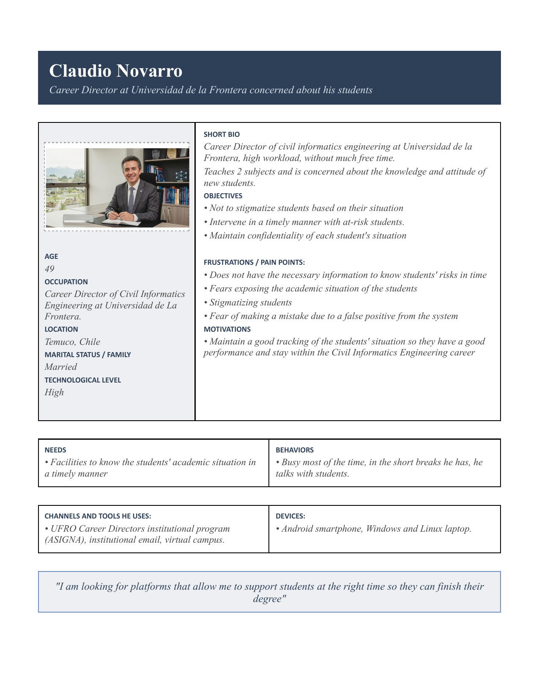
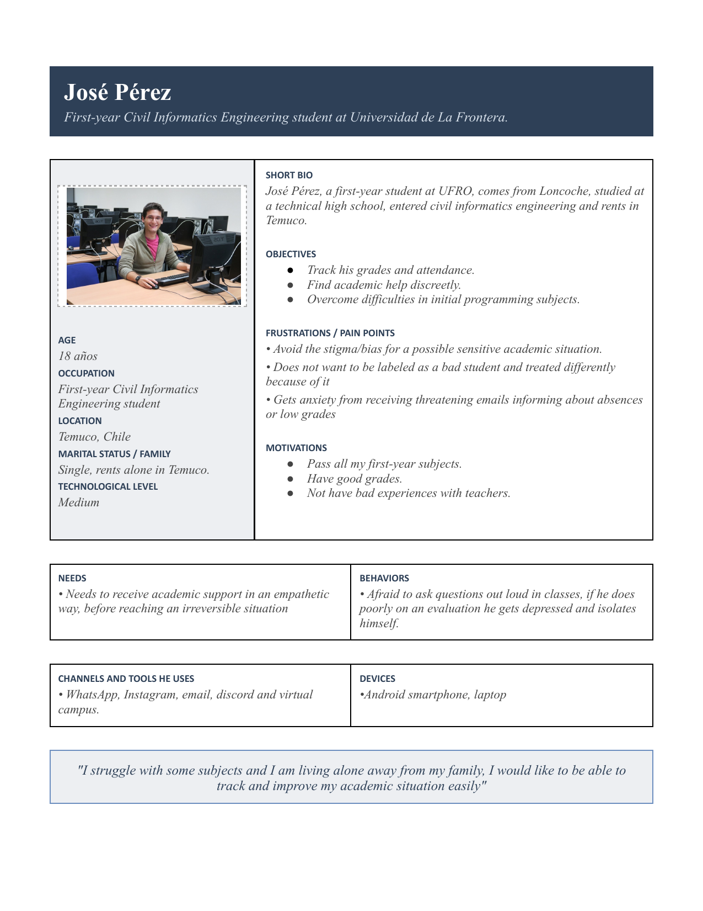
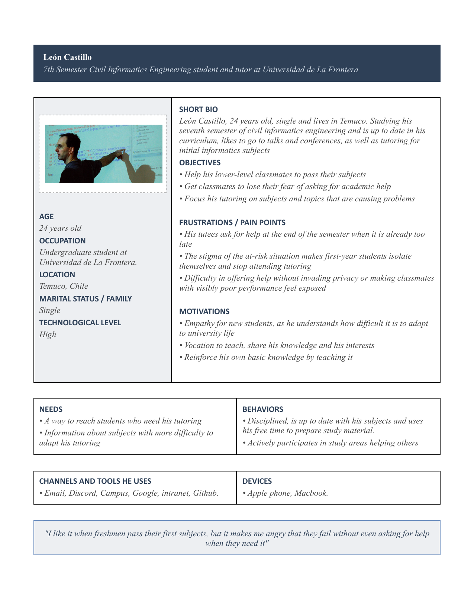
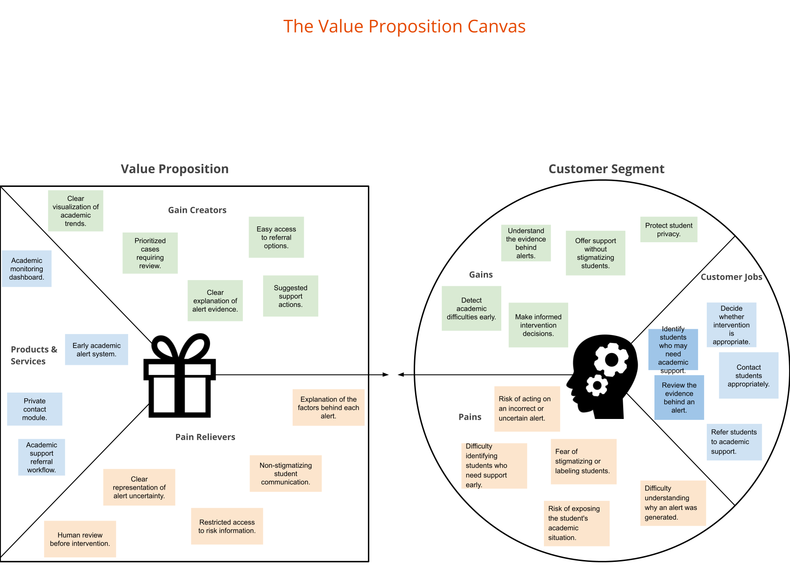
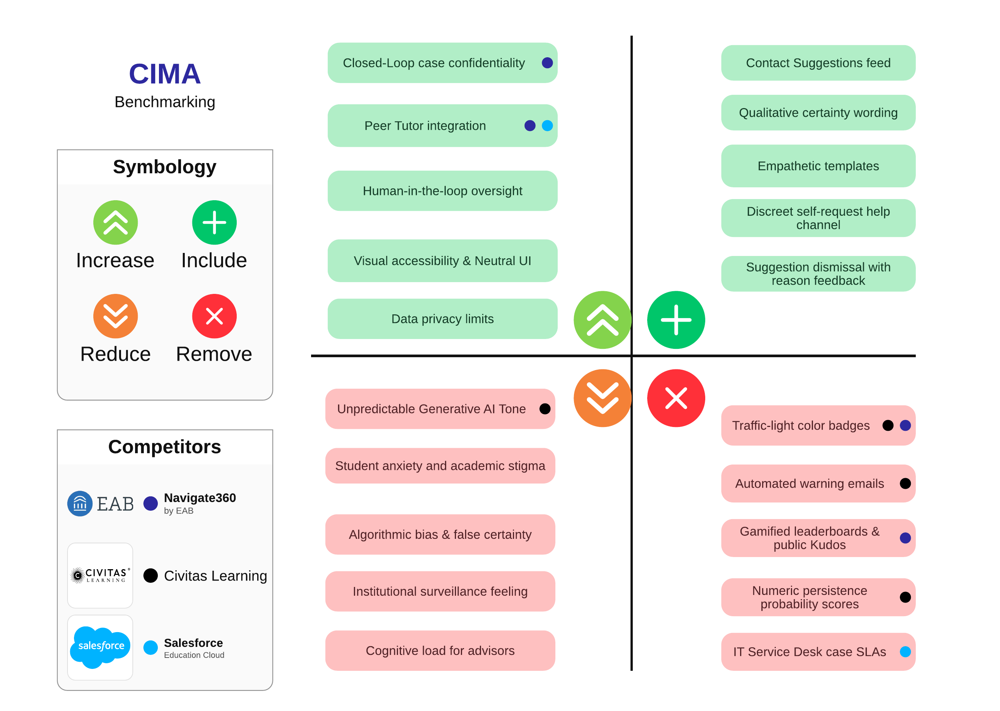
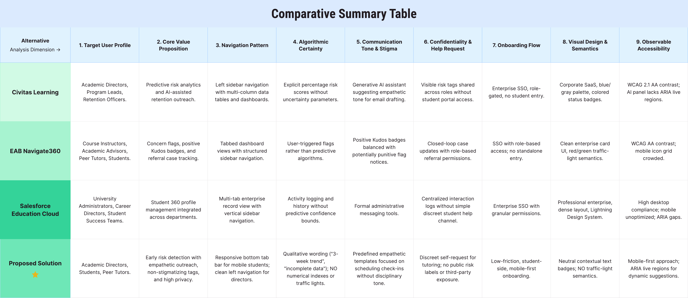
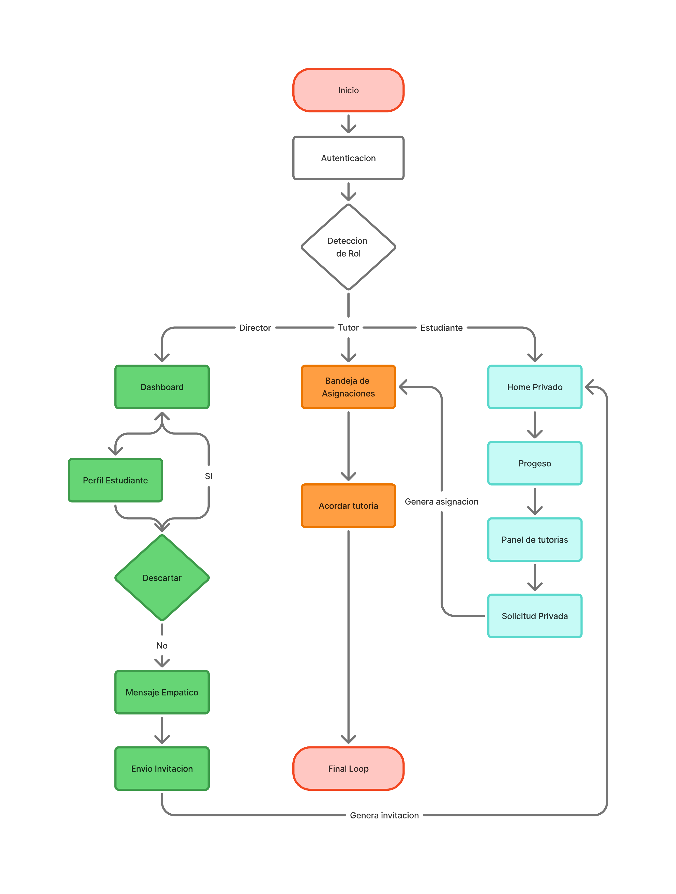
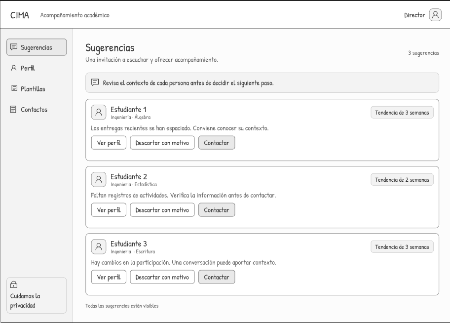
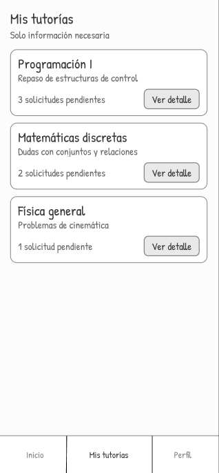
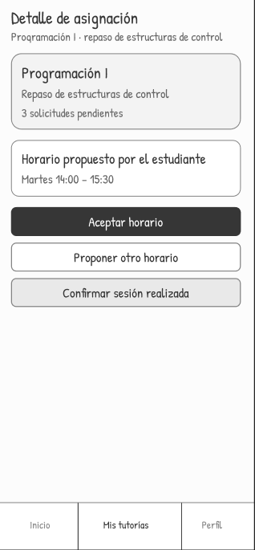

# CIMA - Confidential Intervention & Mentorship Analytics

An empathetic, privacy-first Early Warning System for academic risk management without stigmatization.

**Universidad de La Frontera · October 2026**

---

## Index

- [1. Team Identification and Roles](#1-team-identification-and-roles)
- [2. Problem Statement & Proposed Solution](#2-problem-statement--proposed-solution)
  - [2.1. Problem Statement](#21-problem-statement)
  - [2.2. Solution Overview](#22-solution-overview)
- [3. Layer: Strategy](#3-layer-strategy)
  - [3.1. UX Personas](#31-ux-personas)
  - [3.2. Value Proposition Canvas](#32-value-proposition-canvas)
- [4. Layer: Scope](#4-layer-scope)
  - [4.1. Scope Delimitation & Justification](#41-scope-delimitation--justification)
  - [4.2. Benchmarking](#42-benchmarking)
- [5. Layer: Structure](#5-layer-structure)
  - [5.1. Navigation Flow](#51-navigation-flow)
  - [5.2. Customer Journey Map](#52-customer-journey-map)
- [6. Layer: Skeleton](#6-layer-skeleton)
- [7. Layer: Surface](#7-layer-surface)
- [8. AI Usage Log](#8-ai-usage-log)

> The artifacts above follow the five layers of Jesse James Garrett's
> *The Elements of User Experience* (Strategy → Scope → Structure → Skeleton → Surface).

---

## 1. Team Identification and Roles

* **Leonardo Castellón** — Team Lead
* **Cristóbal Ramos** — Analyst
* **Héctor Rosales** — UX/UI Designer

---

## 2. Problem Statement & Proposed Solution

### 2.1. Problem Statement
Educational institutions calculate academic risk indicators based on attendance, grades, and platform usage. However, algorithmically labeling a student as "at risk" carries significant social side effects: public stigmatization, self-fulfilling prophecies, and unintended disciplinary actions.

The challenge involves two main stakeholders with distinct needs—academic directors seeking timely intervention without labeling students, and students seeking discreet support without feeling judged or exposed. Furthermore, the underlying algorithmic model is inherently fallible and contains uncertainty. The design must resolve what information is shown to whom, how algorithmic uncertainty is transparently expressed, and what concrete, empathetic actions are enabled.

### 2.2. Solution Overview
We propose an empathetic, privacy-first academic support platform. Instead of exposing public risk tags or automated disciplinary notices, the solution provides academic directors with uncertainty-aware risk dashboards and non-stigmatizing communication templates. Students gain access to a private self-management portal where they can check their status and discreetly request tutoring support without fear of public exposure.

---

## 3. Layer: Strategy

### 3.1. UX Personas
Each persona was developed to map the needs of our three core stakeholders, ensuring that our intervention model focuses on privacy and reduces the friction to seek help.

#### Claudio Novarro — Academic Director
* **Goal:** Early, confidential intervention without stigmatizing students.
* **Needs:** Clear risk dashboards with explicit uncertainty indicators.

#### José Pérez — First-Year Student
* **Goal:** Track grades while privately obtaining academic help.
* **Needs:** A non-judgmental portal to request discreet tutoring.

#### León Castillo — Peer Tutor
* **Goal:** Help junior students and reduce help-seeking friction.
* **Needs:** A privacy-preserving mechanism to receive tutoring requests.

### 3.2. Value Proposition Canvas
The Value Proposition Canvas bridges user pains/gains with system features, emphasizing algorithmic transparency, discreet support, and non-stigmatizing communication templates.

---

## 4. Layer: Scope

### 4.1. Scope Delimitation & Justification
To maintain architectural consistency, traceability, and prevent functional overload, the system scope is strictly delimited to **one primary flow** and **two secondary flows**.

**Included Flows:**
* **Primary Flow:** *Early Risk Identification & Confidential Empathetic Outreach (Academic Director).* The Academic Director views student risk indicators alongside algorithmic uncertainty levels and initiates contact using predefined templates.
* **Secondary Flow 1:** *Private Academic Status Tracking & Discreet Help Request (Student).* The student accesses a private view of their academic progress and can discreetly request assistance.
* **Secondary Flow 2:** *Discreet Tutoring Request Management (Peer Tutor).* Peer tutors receive anonymized tutoring assignments based on subject difficulty patterns.

**Out of Scope (Justification):**
* **Direct Course Teacher View:** Excluded to prevent potential classroom bias, unintentional labeling, and privacy leaks during lectures.
* **Automated Sanctions:** The system deliberately omits automated disciplinary notices or penalty workflows to avoid punitive outcomes.
* **Direct Grade Book Modification:** The platform does not alter institutional grade registers or official transcripts.

### 4.2. Benchmarking
The complete competitive benchmark (Civitas Learning, EAB Navigate360, and Salesforce Education Cloud) is consolidated in a single deck, which is the source of truth for this layer.

📄 **[View the Complete Competitive Benchmark Analysis (PDF)](files/benchmark/Benchmark.pdf)**

The deck includes the feature map (map of ideas), the synthetic comparative matrix (9 core UX dimensions), annotated screenshots per tool, key findings, and the design decisions adopted/adapted/avoided. The exploration criteria are summarized in its *Evaluation Dimensions* slide.

#### Feature Map
The feature map defines our market differentiators, including our unique approach to qualitative certainty wording and discreet help channels. Click the image to view the PDF version.

#### Comparative Matrix
The evaluation covers 9 core UX dimensions. Click the image to view the PDF version.

> Note: the exploratory benchmark working notes were consolidated into `Benchmark.pdf`, so there is no separate written exploration guideline document.

---

## 5. Layer: Structure

### 5.1. Navigation Flow
The navigation flow covers **all functionalities of the defined scope** (primary flow + two secondary flows), including the sitemap of every screen and the cross-contact point between roles.

**📄 [View the Navigation Flow — Sitemap & Flow (PDF)](files/structure/navigation_flow.pdf)**

The diagram traces the global entry (role detection) and the three flows of the scope — Academic Director (Dashboard → Student Profile → Dismiss / Empathetic Message → Invitation → Final Loop), Student (Private Home → Progress → Tutoring Panel → Private Request) and Peer Tutor (Assignment Inbox → Agree Tutoring → Final Loop) — including the cross-contact point where a private request generates a tutoring assignment.

### 5.2. Customer Journey Map
Traditional Early Warning Systems map only the administrative flow, ignoring the psychological impact on the student. To ensure CIMA remains empathetic and non-stigmatizing, we developed a **Dual-Track Customer Journey Map** to define the necessary touchpoints and interaction requirements before structuring the application.

This map explicitly traces the emotional and actionable parallel paths of both Claudio (Academic Director) and José (First-Year Student), demonstrating the exact moment where the system cross-contacts them without public exposure.

* **Claudio's Track:** Moves from the tension of evaluating a risk alert to the satisfaction of executing a contextual, empathetic outreach without disciplinary friction.
* **José's Track:** Moves from the anxiety of academic struggles to the relief of receiving a supportive message, culminating in the empowerment of using the discreet self-request channel for tutoring.

**📄 [View the Dual-Track Customer Journey Map (PDF)](files/Customer_journey_map.pdf)**

---

## 6. Layer: Skeleton

Low-fidelity wireframes (sketch style) of the scope's three core screens, kept in `files/wireframes/low-fi/`:

#### D2 Dashboard "Contact Suggestions" (Academic Director)

#### S2 Home + S5 Discreet Tutoring Request (Student)

#### T2 Tutoring Assignment Inbox (Peer Tutor)

> The interface evolution process (low-fi → HD, with key modification reasons) is pending for this milestone.

---

## 7. Layer: Surface

High-definition interfaces of each functionality in scope and the navigable prototype are **pending for this milestone**. HD exports will be stored in `files/mockups/`.

---

## 8. AI Usage Log

Declaration and traceability of AI-assisted decisions on the milestone artifacts.

* **Log file:** [AI-usage-log.md](files/AI-usage-log.md)

> ⏳ Pending: the log is intentionally left empty for this milestone and will be completed with the HD artifacts.
